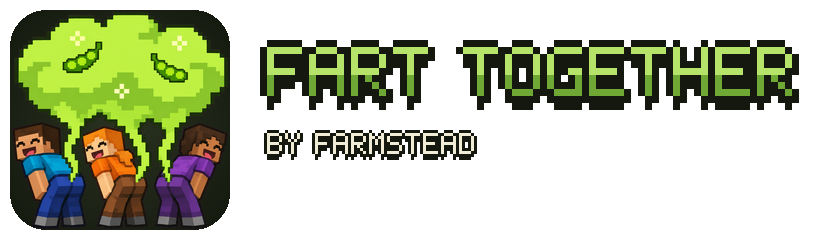
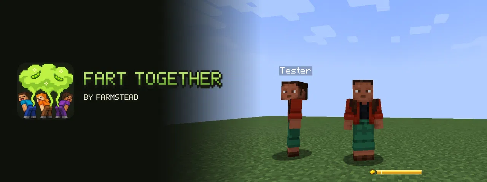
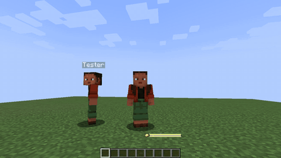
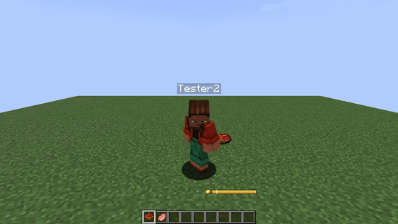
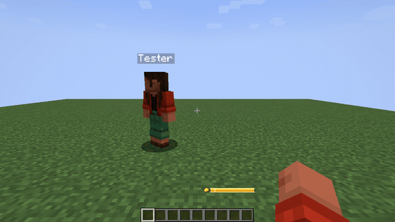
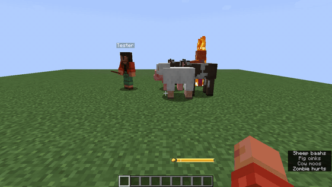
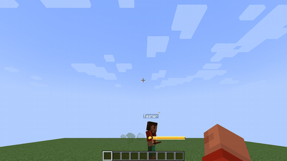
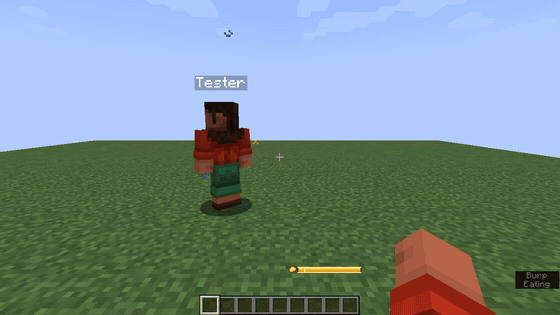

# Fart Together

**Toot with style, toot together.** Press G and your character leans in, a soft puff of gas drifts out behind and one of eight cartoon sounds plays, the same for everyone around. Hold the key to charge a bigger one, eat beans to fill the gas meter, scare mobs away with the cloud, jet-jump over gaps and toot at the same moment as your friends for one huge shared cloud and a chorus. Family-friendly by default: no damage, no gross-out pictures.

By [Farmstead](https://farmsteadminecraft.online). Русская версия — [README.ru.md](README.ru.md).

## See it

| | |
| --- | --- |
|  |  |
| **Toot together: one big shared cloud** | **Hold to charge, the meter shows it** |
|  |  |
| **Your colour, your sound, your pose** | **Mobs run from the cloud** |
|  |  |
| **Jet jump** | **A golden toot after a golden apple** |

More pictures in [docs/media/gallery](docs/media/gallery).

## Features

- **Hold to charge.** Holding the toot key builds strength up to the gas you have; letting go fires it. A quick tap is a small toot. The gas meter above the food row lights up the part that will come out.
- **Gas from food.** Beans 15, cabbage 12, a bowl of beans 60, beetroot soup 35, mushroom stew 30, rotten flesh 20; an enchanted golden apple fills the meter and makes the next toot **golden**; milk settles everything. Any other food gives a little. The weights are data, so datapacks and modpacks can tune them.
- **Four strengths.** Small, medium, big and a full meter, each with its own sounds, loudness and cloud size.
- **Gas clouds.** A toot leaves a cloud behind for a few seconds. Zombies, skeletons, creepers, spiders, animals and villagers smell it and run; creepers forget to explode. Harmless by default; a server can add effects such as nausea, for other players only with PvP rules.
- **Jet jump.** Toot in mid-air and you fly a little higher and land softly.
- **Fart Together.** Two or more players toot within a second and a half of each other: one big shared cloud, a chorus, a combo counter and a short glow. Advancements for 2, 4 and 8 players.
- **Under water** a toot is a stream of bubbles.
- **Nine advancements** in the Husbandry tab, from "Excuse Me!" to "Wind Orchestra" (and a hidden one near the Wither).
- **New crops.** Beans and cabbage drop from grass now and then, grow like wheat, and farmers trade them; beans turn up in village, dungeon, mineshaft and shipwreck chests.
- **Your own style, seen by your friends.** Cloud colour (swamp, bean, lilac, gold, pumpkin, pine, sky, rose, any hex colour, a two-colour gradient, random, rainbow), particle shape (puff, bubbles, sparks, leaves, notes, hearts, snow), size, amount, spread, duration, sound, pitch, volume and pose. The **My style** tab has a live preview with your own character. The server clamps every style to its limits.
- **Streamer-safe mode** turns every sound into a soft "puff"; you can mute other players' toots and cap their particles.
- **Server rules and permissions**: a commented server file with presets, `/fart` commands and LuckPerms nodes for every action, plus meta for cooldown, cloud size and meter size.
- **12 languages:** English, Russian, Chinese (Simplified), Portuguese (Brazil), Spanish, German, French, Polish, Ukrainian, Japanese, Korean, Turkish.

## Downloads and versions

| Minecraft | Fabric / Quilt | NeoForge | Forge | Java |
| --- | --- | --- | --- | --- |
| 26.1 – 26.3 | yes | yes | — | 25 |
| 1.21.7 – 1.21.11 | yes | yes | — | 21 |
| 1.21 – 1.21.5 | yes | yes | — | 21 |
| 1.20.1 | yes | — | yes | 17 |

1.21.6 is not covered.

Get it from [Modrinth](https://modrinth.com/mod/farmstead-fart-together), [CurseForge](https://www.curseforge.com/minecraft/mc-mods/farmstead-fart-together) or [GitHub Releases](https://github.com/shtanko-michael/farmstead-fart-together/releases).

**Requirements:** nothing on NeoForge and Forge. **On Fabric the mod needs [Fabric API](https://modrinth.com/mod/fabric-api).** [Mod Menu](https://modrinth.com/mod/modmenu) is optional and adds a settings button on Fabric.

**Server or client?** Both. Install it on the server and on every client. A client on a server without the mod still toots, but only for itself. Players without the mod see nothing of it; they can still log in, but the beans and cabbage are content their game does not know: a server with vanilla players can set `items.enabled = false` (restart) and the mod adds nothing to the registries.

Chest loot is not added on 26.3 yet (26.3 rewrote the loot builders). On 26.x villager trades come from data and cannot be switched off with `items.beansInVillagerTrades`; a datapack that empties `data/minecraft/tags/villager_trade/farmer/level_1.json` and `level_2.json` entries does.

## Settings

Open them from Mod Menu (Fabric) or the mod list (NeoForge, Forge), type `/farttogether config`, or edit `config/farmstead_fart_together-client.toml`. Presets: `default`, `family`, `performance`.

| Key | Default | What it does |
| --- | --- | --- |
| `general.poses` | `true` | Show the toot pose |
| `general.gasMeter` | `true` | Show the gas meter above the food row |
| `general.streamerSafe` | `false` | Every sound becomes a soft "puff" |
| `general.checkUpdates` | `true` | Look for a newer version on Modrinth once per start (see below) |
| `sounds.volume` | `1.0` | Toot volume (0–2) |
| `sounds.mutedForOthers` | `false` | Do not hear other players' toots |
| `particles.amount` | `1.0` | Particle amount for everything you see (0–3) |
| `particles.lingeringClouds` | `true` | Draw the clouds that stay behind |
| `particles.maxPerToot` | `200` | Cap on particles of another player's toot |
| `style.others` | `theirs` | Others' toots: `theirs` (their style), `simple`, `mine` (your style) |
| `style.color` | `swamp` | A preset name, `#RRGGBB`, `gradient:#A,#B`, `random` or `rainbow` |
| `style.particle` | `puff` | `puff`, `bubbles`, `sparks`, `leaves`, `notes`, `hearts`, `snow` |
| `style.size` / `amount` / `spread` / `duration` | `1.0` | Multipliers (the server caps them) |
| `style.sound` | `random` | `random` (fits the strength) or `short`, `squeaky`, `bubbly`, `long`, `trumpet`, `tiny`, `rumble`, `puff` |
| `style.pitch` / `style.volume` | `1.0` | Pitch 0.5–2, volume 0–1 |
| `style.pose` | `classic` | `classic`, `hero`, `none` |

The key is in Controls → Miscellaneous ("Toot (hold for more)").

## Server file

`config/farmstead_fart_together-server.toml`, presets `default`, `family` (longer cooldown, no effects), `plain` (no personal styles), `chaos` (fast toots, big clouds with nausea that reach other players, stronger jet jumps, a wider combo window).

| Section | Keys |
| --- | --- |
| `toot` | `cooldownSeconds` (3), `fullChargeSeconds` (1.5: how long a hold takes to let out all the gas) |
| `charge` | `required`, `max` (100), `minToToot` (10: also what a tap lets out), `passivePerMinute`, `unlistedFood`, `goldenApple` |
| `cloud` | `enabled`, `durationSeconds`, `radius`, `scareMobs`, `scareRange`, `scaredMobs` (ids or `#tags`), `effects` (`"minecraft:nausea 4 1"`), `affectsPlayers` (off: no PvP), `respectServerPvp` |
| `jetJump` | `enabled`, `strength` (0.6), `slowFallSeconds` (1.5) |
| `together` | `enabled`, `windowSeconds` (1.5), `radius` (6), `glow` |
| `items` | `enabled` (dedicated servers, restart), `beansFromGrass`, `cabbageSeedsFromGrass`, `beansInVillagerTrades`, `beansInLoot` |
| `style` | `allowCustom`, `maxSize`, `maxAmount`, `maxDuration`, `allowedParticles`, `allowedSounds`, `updateCooldownSeconds` |

Gas weights live in `data/<namespace>/gas_foods/*.json`, for example `{"foods": {"minecraft:beetroot": 10, "#c:foods/vegetable": 4}}`. A datapack changes ours by shipping the same path (`data/farmstead_fart_together/gas_foods/vanilla.json`) or adds its own file; `/reload` or `/fart reload` applies it.

## Commands

| Command | Who | What |
| --- | --- | --- |
| `/fart info` | everyone | your gas, cooldown, cloud radius; the server's rules |
| `/fart reload` | operators | reads the server file and the gas food tables again |
| `/fart charge <players> <amount>` / `full` | operators | sets gas |
| `/fart toggle <players>` | operators | switches a player's toots off or back on |
| `/farttogether reload` / `config` | client | your own settings |

## Permissions

LuckPerms or any permission mod of the loader.

| Node | Default | What it allows |
| --- | --- | --- |
| `farmstead_fart_together.use` | everyone | toot |
| `farmstead_fart_together.jetjump` | everyone | a toot in mid-air pushes you up |
| `farmstead_fart_together.together` | everyone | count in Fart Together combos |
| `farmstead_fart_together.style.custom` | everyone | a personal style (otherwise the plain green puff) |
| `farmstead_fart_together.style.rainbow` | nobody | gradient and rainbow colours |
| `farmstead_fart_together.style.huge` | nobody | size and duration caps x1.5 |
| `farmstead_fart_together.style.sounds.rare` | nobody | rare sounds by name (none yet) |
| `farmstead_fart_together.cloud.bypass` | nobody | cloud effects never reach this player |
| `farmstead_fart_together.command.info` | everyone | `/fart info` |
| `farmstead_fart_together.command.reload` | operators | `/fart reload` |
| `farmstead_fart_together.command.charge` | operators | `/fart charge` |
| `farmstead_fart_together.command.toggle` | operators | `/fart toggle` |

| Meta (number) | Default | What it sets |
| --- | --- | --- |
| `farmstead_fart_together.cooldown` | `toot.cooldownSeconds` | seconds between toots |
| `farmstead_fart_together.cloud.radius` | `cloud.radius` | radius of a full-strength cloud |
| `farmstead_fart_together.charge.max` | `charge.max` | size of the gas meter |

Example: `/lp group vip meta set farmstead_fart_together.cooldown 1`. On NeoForge and Forge the meta is read through the loader's permission API (string nodes), on Fabric through fabric-permissions-api's options.

## Update check

Once per start the mod asks Modrinth whether a newer version exists and writes one line to the log (the About tab of the settings shows it too). Nothing else is sent. Turn it off with `general.checkUpdates = false` or `-Dfarmstead.updateCheck=false` (servers).

## FAQ

- **Is it safe for kids and streams?** Yes: no damage by default, cartoon sounds, no gross pictures, and `general.streamerSafe` swaps every sound for a soft puff.
- **Does it work with other animation mods?** The pose is laid over the vanilla model after it is posed, so it does not replace other animations; it is short (just over a second).
- **Can I add gas to modded food?** Yes, with a datapack: `data/<any>/gas_foods/<any>.json`, ids or `#tags`.
- **Why does Fabric need Fabric API?** For networking (styles and toots go through the server), the mod's own sounds, textures and crops, and registry sync. NeoForge and Forge have all of that built in.

## Building

    JAVA_HOME=<JDK 25> ./gradlew build                         # every target
    JAVA_HOME=<JDK 25> ./gradlew :1.21.1-neoforge:build        # one target
    python -I tools/lang.py                                   # write and check the 12 lang files (and every key the code uses)
    python -I tools/gen_content.py                            # models, blockstates, loot, recipe, gas foods, advancements, 26.x trades
    python -I tools/art.py install                            # the texture variants chosen in art/textures/slots.json
    python -I tools/sounds.py install                         # the sound takes chosen in art/sounds/slots.json
    python -I tools/duo.py 1.21.1-neoforge [--record]         # two clients on one server: every feature, screenshots (and GIF frames)
    python -I tools/build_wiki.py                             # docs/wiki/{en,ru} from the READMEs

Data files are written once in the 1.21.2+ form; `buildSrc/src/main/kotlin/DataCompat.kt` rewrites folder names, recipe and advancement shapes for older targets while the jar is built.

## License

Code — MIT, assets (textures, sounds, icon) — CC BY-NC 4.0 (see [LICENSE](LICENSE)). Sounds made with ElevenLabs, textures and icon with Codex, picked by hand.
