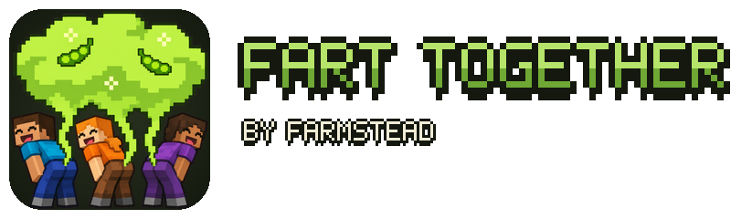
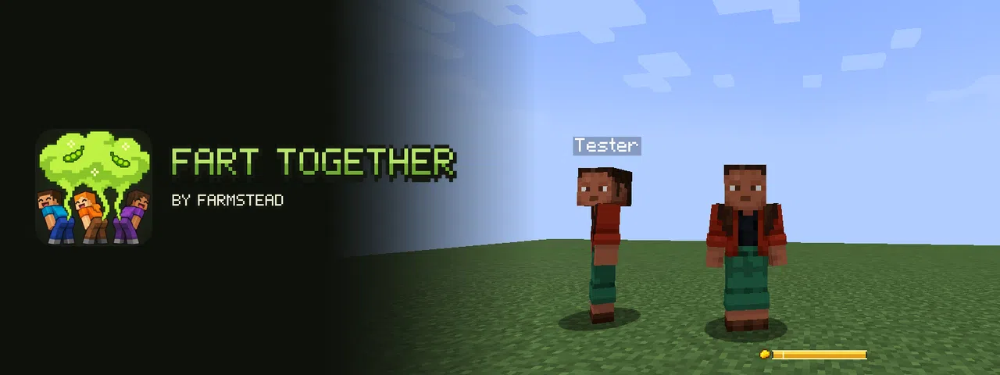
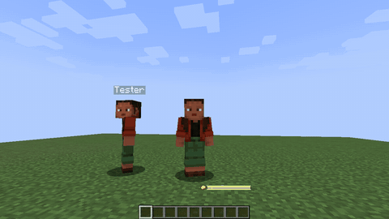
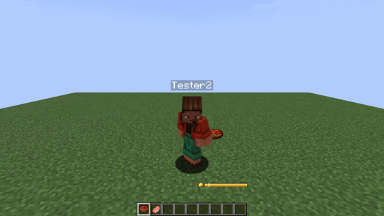
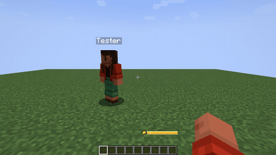
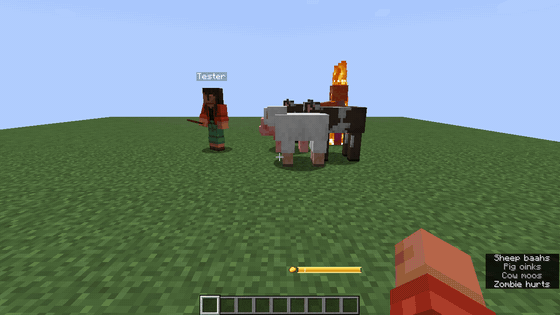
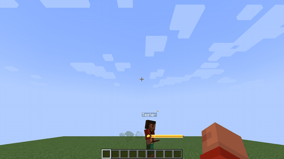
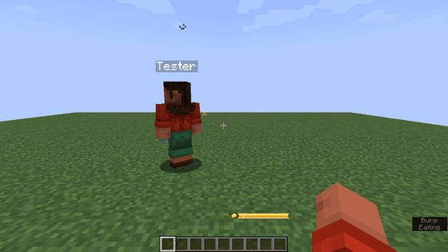

# Fart Together

**Пускайте газы со стилем — и вместе.** Нажмите G: персонаж наклоняется, сзади выплывает мягкое облачко газа и звучит один из восьми мультяшных звуков, одинаковый для всех вокруг. Держите клавишу, чтобы зарядить залп посильнее, ешьте бобы, чтобы наполнить шкалу газа, пугайте мобов облаком, взлетайте реактивным прыжком и делайте залп одновременно с друзьями — получится одно огромное общее облако и хор. По умолчанию для всей семьи: никакого урона и неприличных картинок.

От [Farmstead](https://farmsteadminecraft.online). English version — [README.md](README.md).

## Посмотреть

| | |
| --- | --- |
|  |  |
| **Вместе: одно большое общее облако** | **Удержание — сила, шкала показывает** |
|  |  |
| **Ваш цвет, звук и поза** | **Мобы убегают от облака** |
|  |  |
| **Реактивный прыжок** | **Золотой залп после золотого яблока** |

Больше картинок — в [docs/media/gallery](docs/media/gallery).

## Возможности

- **Удержание — сила.** Пока клавиша зажата, залп набирает силу — до того газа, что у вас есть; отпустили — выстрел. Короткое нажатие — маленький залп. Шкала газа над едой подсвечивает ту часть, что выйдет.
- **Газ от еды.** Бобы 15, капуста 12, миска бобов 60, борщ 35, грибной суп 30, гнилая плоть 20; зачарованное золотое яблоко наполняет шкалу и делает следующий залп **золотым**; молоко всё успокаивает. Любая другая еда даёт чуть-чуть. Веса — данные: датапаки и сборки могут их менять.
- **Четыре силы.** Малый, средний, большой и полная шкала — у каждого свои звуки, громкость и размер облака.
- **Облака газа.** После залпа облако висит несколько секунд. Зомби, скелеты, криперы, пауки, животные и жители чуют его и убегают, криперы забывают взорваться. По умолчанию безвредно; сервер может добавить эффекты вроде тошноты, на других игроков — только по правилам PvP.
- **Реактивный прыжок.** Залп в воздухе подбрасывает чуть выше и смягчает приземление.
- **Fart Together.** Двое и больше игроков делают залп в пределах полутора секунд: одно большое общее облако, хор, счётчик комбо и короткая подсветка. Ачивки за 2, 4 и 8 игроков.
- **Под водой** залп — поток пузырей.
- **Девять ачивок** во вкладке «Хозяйство» — от «Пардон!» до «Духового оркестра» (и скрытая рядом с Иссушителем).
- **Новые культуры.** Бобы и капуста иногда выпадают из травы, растут как пшеница, фермеры ими торгуют; бобы попадаются в сундуках деревень, данжей, шахт и кораблей.
- **Свой стиль, который видят друзья.** Цвет облака (swamp, bean, lilac, gold, pumpkin, pine, sky, rose, любой HEX, градиент из двух цветов, случайный, радуга), форма частиц (пух, пузыри, искры, листья, ноты, сердечки, снег), размер, количество, разлёт, длительность, звук, тон, громкость и поза. Во вкладке **«Мой стиль»** — живое превью с вашим персонажем. Сервер обрезает стиль до своих лимитов.
- **Режим для стримов** заменяет все звуки мягким «пуф»; можно заглушить чужие залпы и ограничить их частицы.
- **Правила сервера и права**: серверный конфиг с комментариями и пресетами, команды `/fart`, узлы LuckPerms на каждое действие и meta для кулдауна, размера облака и шкалы.
- **12 языков:** английский, русский, китайский (упрощённый), португальский (Бразилия), испанский, немецкий, французский, польский, украинский, японский, корейский, турецкий.

## Загрузки и версии

| Minecraft | Fabric / Quilt | NeoForge | Forge | Java |
| --- | --- | --- | --- | --- |
| 26.1 – 26.3 | да | да | — | 25 |
| 1.21.7 – 1.21.11 | да | да | — | 21 |
| 1.21 – 1.21.5 | да | да | — | 21 |
| 1.20.1 | да | — | да | 17 |

1.21.6 не поддерживается.

Скачать: [Modrinth](https://modrinth.com/mod/farmstead-fart-together), [CurseForge](https://www.curseforge.com/minecraft/mc-mods/farmstead-fart-together), [GitHub Releases](https://github.com/shtanko-michael/farmstead-fart-together/releases).

**Что нужно:** на NeoForge и Forge — ничего. **На Fabric мод требует [Fabric API](https://modrinth.com/mod/fabric-api).** [Mod Menu](https://modrinth.com/mod/modmenu) — по желанию, добавляет кнопку настроек на Fabric.

**Сервер или клиент?** Оба. Ставьте на сервер и на каждый клиент. Клиент на сервере без мода всё равно пускает газы, но только для себя. Игроки без мода ничего не видят; войти они могут, но бобы и капуста — незнакомый их игре контент: серверу с ванильными игроками стоит поставить `items.enabled = false` (перезапуск) — тогда мод ничего не добавляет в реестры.

На 26.3 бобы в сундуки пока не добавляются (26.3 переписал построители лута). На 26.x торги жителей — это данные, и `items.beansInVillagerTrades` их не выключает; выключает датапак, который убирает наши записи из `data/minecraft/tags/villager_trade/farmer/level_1.json` и `level_2.json`.

## Настройки

Открываются из Mod Menu (Fabric) или списка модов (NeoForge, Forge), командой `/farttogether config` или в файле `config/farmstead_fart_together-client.toml`. Пресеты: `default`, `family`, `performance`.

| Ключ | По умолчанию | Что делает |
| --- | --- | --- |
| `general.poses` | `true` | Показывать позу |
| `general.gasMeter` | `true` | Шкала газа над едой |
| `general.streamerSafe` | `false` | Все звуки — мягкий «пуф» |
| `general.checkUpdates` | `true` | Раз за запуск спросить Modrinth о новой версии (см. ниже) |
| `sounds.volume` | `1.0` | Громкость залпов (0–2) |
| `sounds.mutedForOthers` | `false` | Не слышать чужие залпы |
| `particles.amount` | `1.0` | Количество частиц во всём, что вы видите (0–3) |
| `particles.lingeringClouds` | `true` | Рисовать остающиеся облака |
| `particles.maxPerToot` | `200` | Потолок частиц чужого залпа |
| `style.others` | `theirs` | Чужие залпы: `theirs` (их стиль), `simple`, `mine` (ваш стиль) |
| `style.color` | `swamp` | Имя пресета, `#RRGGBB`, `gradient:#A,#B`, `random` или `rainbow` |
| `style.particle` | `puff` | `puff`, `bubbles`, `sparks`, `leaves`, `notes`, `hearts`, `snow` |
| `style.size` / `amount` / `spread` / `duration` | `1.0` | Множители (сервер их ограничивает) |
| `style.sound` | `random` | `random` (по силе) или `short`, `squeaky`, `bubbly`, `long`, `trumpet`, `tiny`, `rumble`, `puff` |
| `style.pitch` / `style.volume` | `1.0` | Тон 0,5–2, громкость 0–1 |
| `style.pose` | `classic` | `classic`, `hero`, `none` |

Клавиша — в «Управление» → «Разное» («Залп (держите — сильнее)»).

## Серверный конфиг

`config/farmstead_fart_together-server.toml`, пресеты `default`, `family` (кулдаун длиннее, без эффектов), `plain` (без личных стилей), `cosmetic` (только украшение: газ не нужен, мобы не пугаются, у облака нет эффектов, реактивный прыжок не подбрасывает, комбо без подсветки — залп только выглядит и звучит), `chaos` (частые залпы, большие облака с тошнотой, которые достают других игроков, сильный реактивный прыжок, окно комбо шире).

| Секция | Ключи |
| --- | --- |
| `toot` | `cooldownSeconds` (3), `fullChargeSeconds` (1,5: за сколько удержание выпускает весь газ) |
| `charge` | `required`, `max` (100), `minToToot` (10: столько же выпускает короткое нажатие), `passivePerMinute`, `unlistedFood`, `goldenApple` |
| `cloud` | `enabled`, `durationSeconds`, `radius`, `scareMobs`, `scareRange`, `scaredMobs` (id или `#теги`), `effects` (`"minecraft:nausea 4 1"`), `affectsPlayers` (выкл.: без PvP), `respectServerPvp` |
| `jetJump` | `enabled`, `strength` (0,6), `slowFallSeconds` (1,5) |
| `together` | `enabled`, `windowSeconds` (1,5), `radius` (6), `glow` |
| `items` | `enabled` (выделенный сервер, перезапуск), `beansFromGrass`, `cabbageSeedsFromGrass`, `beansInVillagerTrades`, `beansInLoot` |
| `style` | `allowCustom`, `maxSize`, `maxAmount`, `maxDuration`, `allowedParticles`, `allowedSounds`, `updateCooldownSeconds` |

Веса газа — в `data/<namespace>/gas_foods/*.json`, например `{"foods": {"minecraft:beetroot": 10, "#c:foods/vegetable": 4}}`. Датапак меняет наши, положив файл по тому же пути (`data/farmstead_fart_together/gas_foods/vanilla.json`), или добавляет свой; применяется `/reload` или `/fart reload`.

## Команды

| Команда | Кто | Что |
| --- | --- | --- |
| `/fart info` | все | ваш газ, кулдаун, радиус облака; правила сервера |
| `/fart reload` | операторы | перечитать серверный конфиг и таблицы газа |
| `/fart charge <игроки> <число>` / `full` | операторы | задать газ |
| `/fart toggle <игроки>` | операторы | выключить или вернуть игроку залпы |
| `/farttogether reload` / `config` | клиент | ваши настройки |

## Права

LuckPerms или любой мод прав лоадера. Проверено вживую с LuckPerms на Fabric и NeoForge. На NeoForge 1.21.1 ставьте LuckPerms 5.4.150 или новее с [luckperms.net](https://luckperms.net/download): 5.4.140, последняя сборка для NeoForge на Modrinth, выкидывает каждого игрока при входе («Invalid player data») (ошибка LuckPerms, исправлена в более новых сборках).

| Узел | По умолчанию | Что даёт |
| --- | --- | --- |
| `farmstead_fart_together.use` | все | пускать газы |
| `farmstead_fart_together.jetjump` | все | залп в воздухе подбрасывает |
| `farmstead_fart_together.together` | все | участвовать в комбо Fart Together |
| `farmstead_fart_together.style.custom` | все | личный стиль (иначе простое зелёное облачко) |
| `farmstead_fart_together.style.rainbow` | никто | градиенты и радуга |
| `farmstead_fart_together.style.huge` | никто | потолки размера и длительности ×1,5 |
| `farmstead_fart_together.style.sounds.rare` | никто | редкие звуки по выбору (пока нет) |
| `farmstead_fart_together.cloud.bypass` | никто | эффекты облака не действуют |
| `farmstead_fart_together.command.info` | все | `/fart info` |
| `farmstead_fart_together.command.reload` | операторы | `/fart reload` |
| `farmstead_fart_together.command.charge` | операторы | `/fart charge` |
| `farmstead_fart_together.command.toggle` | операторы | `/fart toggle` |

| Meta (число) | По умолчанию | Что задаёт |
| --- | --- | --- |
| `farmstead_fart_together.cooldown` | `toot.cooldownSeconds` | секунд между залпами |
| `farmstead_fart_together.cloud.radius` | `cloud.radius` | радиус облака полного залпа |
| `farmstead_fart_together.charge.max` | `charge.max` | размер шкалы газа |

Пример: `/lp group vip meta set farmstead_fart_together.cooldown 1`. На NeoForge и Forge meta читается через API прав лоадера (строковые узлы), на Fabric — через options из fabric-permissions-api.

## Проверка обновлений

Раз за запуск мод спрашивает Modrinth, нет ли новой версии, и пишет одну строку в лог (её же показывает вкладка «О моде»). Больше ничего не отправляется. Выключается `general.checkUpdates = false` или `-Dfarmstead.updateCheck=false` (сервер).

## Вопросы

- **Подходит детям и для стримов?** Да: по умолчанию без урона, мультяшные звуки, без неприличных картинок, а `general.streamerSafe` заменяет все звуки мягким «пуф».
- **Совместим с другими модами анимаций?** Поза накладывается поверх ванильной модели после её позы, не заменяя другие анимации, и длится чуть больше секунды.
- **Можно добавить газ модовой еде?** Да, датапаком: `data/<любое>/gas_foods/<любое>.json`, id или `#теги`.
- **Зачем Fabric API на Fabric?** Сеть (стили и залпы идут через сервер), свои звуки, текстуры и культуры, синхронизация реестров. В NeoForge и Forge всё это встроено.

## Сборка

    JAVA_HOME=<JDK 25> ./gradlew build                         # все цели
    JAVA_HOME=<JDK 25> ./gradlew :1.21.1-neoforge:build        # одна цель
    python -I tools/lang.py                                   # 12 языковых файлов и проверка всех ключей из кода
    python -I tools/gen_content.py                            # модели, blockstates, лут, рецепт, газ, ачивки, торги 26.x
    python -I tools/art.py install                            # варианты текстур из art/textures/slots.json
    python -I tools/sounds.py install                         # дубли звуков из art/sounds/slots.json
    python -I tools/duo.py 1.21.1-neoforge [--record]         # два клиента на одном сервере: все функции, скриншоты (и кадры GIF)
    python -I tools/build_wiki.py                             # docs/wiki/{en,ru} из README

Файлы данных пишутся один раз в форме 1.21.2+; `buildSrc/src/main/kotlin/DataCompat.kt` при сборке переделывает папки, рецепты и ачивки для старых целей.

## Лицензия

Код — MIT, ассеты (текстуры, звуки, иконка) — CC BY-NC 4.0 (см. [LICENSE](LICENSE)). Звуки сделаны в ElevenLabs, текстуры и иконка — в Codex, отобраны вручную.
