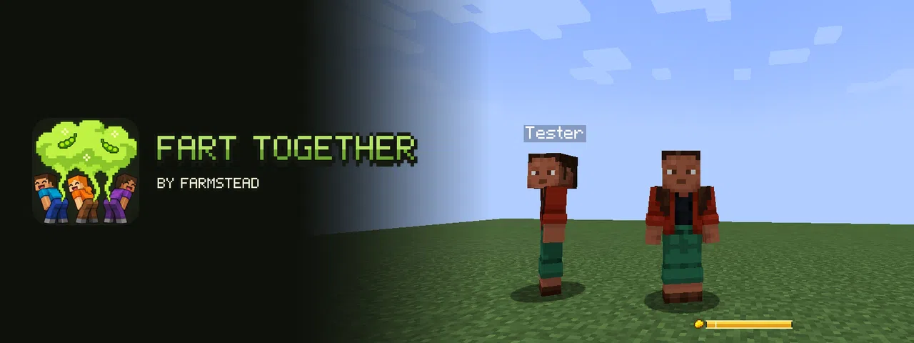
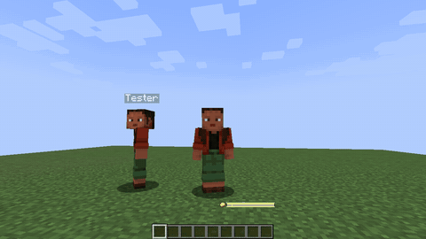
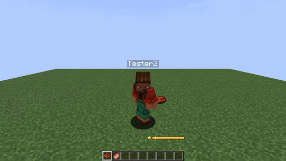
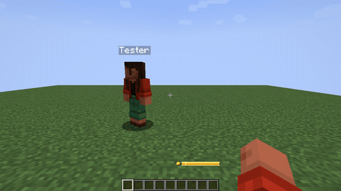
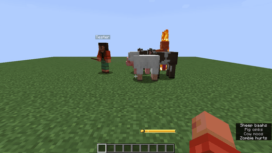
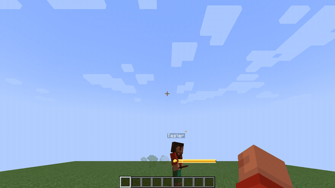
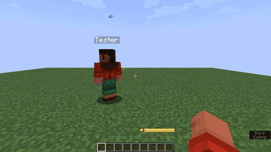

# Toot with style. Toot together.

**Fart Together** turns the oldest joke in the world into a little game. Press **G** and your character leans in, a soft puff of gas drifts out behind and one of eight cartoon sounds plays, exactly the same for everyone around. **Hold the key** to charge a bigger one. Eat beans to fill your gas meter, scare mobs away with the cloud, jet-jump over gaps and toot at the same moment as your friends for one huge shared cloud and a chorus.

**Family-friendly by default:** no damage, cartoon sounds, no gross pictures, and a streamer-safe mode that turns every sound into a soft "puff".

---

## ✦ See it

| | |
| --- | --- |
|  **Toot together: one big shared cloud** |  **Hold to charge, the meter shows it** |
|  **Your colour, your sound, your pose** |  **Mobs run from the cloud** |
|  **Jet jump** |  **A golden toot after a golden apple** |

## ✦ Real gameplay

- **Hold to charge.** Holding the key builds strength up to the gas you have; letting go fires it. A quick tap is a small toot. The gas meter lights up the part that will come out.
- **Gas from food.** Beans, cabbage and a bowl of beans are new crops and food; beetroot soup, mushroom stew and rotten flesh work too. An **enchanted golden apple** makes the next toot golden. Milk settles everything. Datapacks can set the gas of any food, modded food included.
- **Clouds that scare mobs.** Zombies, skeletons, creepers, spiders, animals and villagers smell the cloud and run; creepers forget to explode. Harmless by default; servers can add effects.
- **Jet jump.** Toot in mid-air to fly a little higher and land softly.
- **Fart Together.** Two or more players toot within a moment: one big shared cloud, a chorus, a combo counter and a short glow.
- **Under water** a toot is a stream of bubbles.
- **Nine advancements**, from "Excuse Me!" to "Wind Orchestra" (eight players at once), and a hidden one near the Wither.
- **New crops** drop from grass, farmers trade them, chests hide them.

## ✦ Your style, seen by your friends

Pick the colour of your cloud (presets, any hex colour, a gradient, random, rainbow), the particles (soft puff, bubbles, sparks, leaves, notes, hearts, snow), size, amount, sound, pitch and pose. The **My style** tab shows your own character with a live preview. Everyone around sees and hears your style; the server keeps it within its limits.

## ✦ For servers

- A commented server file with presets (`family`, `plain`, `chaos`): cooldown, gas, clouds, effects, jet jump, combos, items, styles.
- `/fart info | reload | charge | toggle`.
- **LuckPerms** nodes for every action and meta for cooldown, cloud size and meter size.
- Vanilla players can join; a server for them can switch the new items off.

## ✦ 12 languages

English, Русский, 简体中文, Português (Brasil), Español, Deutsch, Français, Polski, Українська, 日本語, 한국어, Türkçe.

## ✦ Versions and requirements

| Minecraft | Loaders |
| --- | --- |
| 26.1 – 26.3 | Fabric, Quilt, NeoForge |
| 1.21.7 – 1.21.11 | Fabric, Quilt, NeoForge |
| 1.21 – 1.21.5 | Fabric, Quilt, NeoForge |
| 1.20.1 | Fabric, Quilt, Forge |

- **Fabric needs [Fabric API](https://modrinth.com/mod/fabric-api).** NeoForge and Forge need nothing else.
- Install it **on the server and on every client**. On a server without the mod your toots are only for you.
- [Mod Menu](https://modrinth.com/mod/modmenu) is optional on Fabric (settings button).

---

Made by [Farmstead](https://farmsteadminecraft.online) · [Source](https://github.com/shtanko-michael/farmstead-fart-together) · [Issues](https://github.com/shtanko-michael/farmstead-fart-together/issues) · Code MIT, assets CC BY-NC 4.0.
